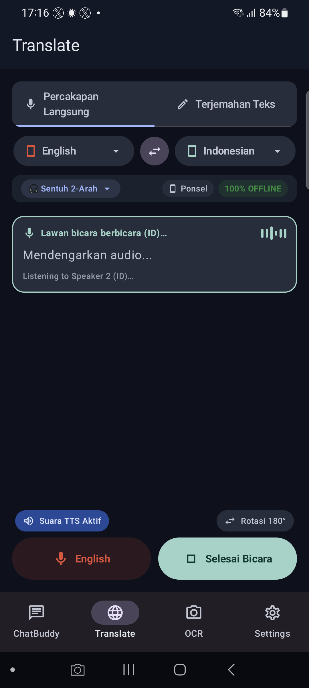
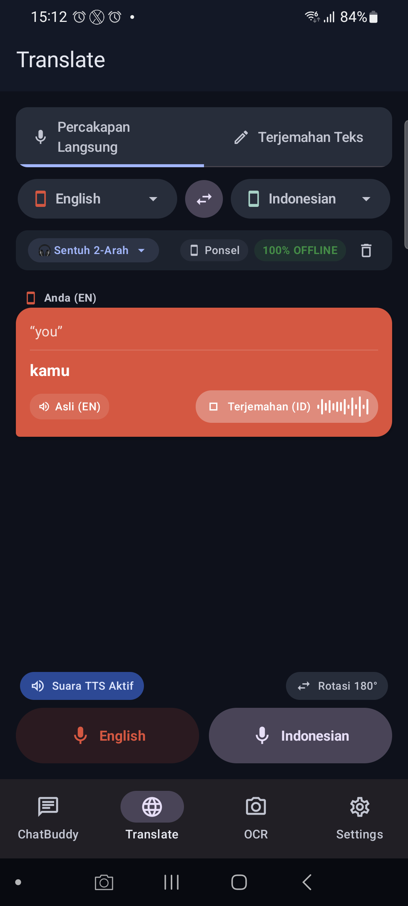
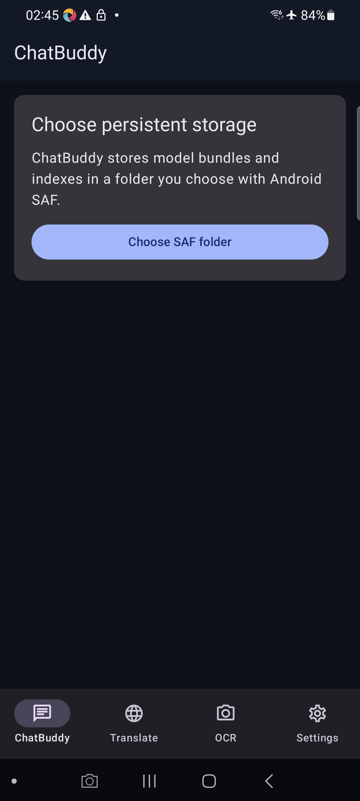
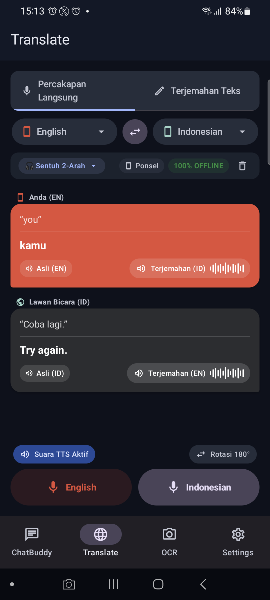

# 🤖 ChatBuddy

<div align="center">

**100% Offline AI Travel Companion & Local Assistant for Android**<br/>
*Two-Way Live Voice Translation (SayMi/Timekettle-style), Offline RAG Knowledge, Camera OCR, and On-Device LLM*

[](https://github.com/Adrian463588/ChatBuddy/releases/tag/v0.2.0)
[-blue.svg?style=for-the-badge&logo=android)](https://github.com/Adrian463588/ChatBuddy/releases/download/v0.2.0/ChatBuddy-v0.2.0.apk)
[](LICENSE)
[-blueviolet.svg?style=for-the-badge&logo=android)](https://android.com)

---

### 📥 Unduh Langsung APK Terbaru (v0.2.0)
Klik tombol di bawah untuk mendownload installer APK langsung ke HP Android Anda:

[](https://github.com/Adrian463588/ChatBuddy/releases/download/v0.2.0/ChatBuddy-v0.2.0.apk)

**Link Alternatif / Semua Versi:** [Halaman GitHub Releases](https://github.com/Adrian463588/ChatBuddy/releases/latest)

#### 🚀 Cara Pasang Cepat di HP Android:
1. Klik **[Unduh ChatBuddy-v0.2.0.apk](https://github.com/Adrian463588/ChatBuddy/releases/download/v0.2.0/ChatBuddy-v0.2.0.apk)** di atas melalui browser HP Anda.
2. Setelah selesai, buka notifikasi unduhan lalu pilih **Install** *(Jika muncul peringatan keamanan, izinkan "Install unknown apps / Izinkan dari sumber ini")*.
3. Buka ChatBuddy, berikan izin mikrofon/penyimpanan, dan aplikasi langsung siap digunakan **100% offline tanpa kuota internet**!

---
</div>

## 📸 Tangkapan Layar Aplikasi (Samsung Galaxy S20 Ultra)

Berikut adalah tangkapan layar langsung dari perangkat fisik nyata (**Samsung Galaxy S20 Ultra `SM-G988B`**, Android 13):

<div align="center">

| 🎙️ Mode Mendengarkan (Silero Neural VAD) | 💬 Riwayat Percakapan 2-Arah (SayMi Style) | 🔊 Pemutaran TTS Offline Aktif |
|:---:|:---:|:---:|
|  |  |  |
| *Deteksi vokal cerdas Silero VAD v5 dengan visualizer gelombang suara.* | *Gelembung dialog 2 penutur dengan kontrol suara ganda Asli & Terjemahan.* | *Pemutaran instan suara Bahasa Indonesia / Inggris secara offline.* |

</div>

<br>

<div align="center">

| 🤖 Asisten AI ChatBuddy & Dokumen RAG | 🌐 Pengaturan Bahasa & Audio |
|:---:|:---:|
|  |  |
| *Tanya jawab dokumen lokal via embedding MiniLM & sqlite-vec.* | *Pilihan pasangan bahasa interaktif dengan dukungan audio dua arah.* |

</div>

---

## 🌟 Fitur Unggulan

### 1. 🎙️ Live Two-Way Conversation Translation (Gaya SayMi / Timekettle)
- **AI Companion untuk Traveling Tanpa Device Khusus**: Berbicara langsung dengan lawan bicara di mana saja tanpa perlu membeli earphone translator mahal (seperti Timekettle) atau perangkat khusus. Cukup gunakan mikrofon ponsel atau earphone Bluetooth TWS standar apa pun.
- **Silero Neural VAD v5 On-Device (~2.3 MB)**:
  - Menggantikan algoritma energi lama dengan deep neural network LSTM berakurasi tinggi.
  - Kebal terhadap desau AC, kipas angin, sentuhan bodi ponsel, maupun hembusan napas.
  - **Jeda Bicara Alami (1200ms)**: Tidak memotong kalimat di tengah jalan saat Anda berpikir sejenak.
  - **Eliminasi Terjemahan Palsu**: Suara hening tidak akan pernah memicu transkripsi halusinasi.
- **Kontrol Audio Ganda (Dual Playback Chips)**:
  - Setiap kartu percakapan menyediakan 2 tombol suara mandiri:
    - **`🔊 Asli`**: Memutar audio teks bahasa asal yang diucapkan pembicara.
    - **`🔊 Terjemahan`**: Memutar audio hasil terjemahan untuk lawan bicara.
- **Riwayat Dialog Otomatis**: Riwayat percakapan ditumpuk rapi di bagian bawah layar dengan auto-scroll ke giliran paling akhir.

### 2. 📚 Offline Document RAG (Retrieval-Augmented Generation)
- **100% Pemrosesan Lokal**: Membaca dokumen TXT, PDF, dan DOCX tanpa mengunggah sebutir data pun ke cloud.
- **On-Device Embedding**: Model `all-MiniLM-L6-v2` INT8 quantized (~23 MB) berjalan via ONNX Runtime Mobile (`IntraOpNumThreads = 2`).
- **Vector Database On-Device**: Pencarian kemiripan semantik berbasis `sqlite-vec` bawaan C++ dengan fallback exact cosine similarity di Room Database.
- **Web Fallback Opsional**: Jika pengguna mengaktifkan toggle `Search web if local sources miss`, pencarian HTTPS hanya dilakukan jika tidak ditemukan bukti pada dokumen lokal.

### 3. 👁️ Live Camera OCR & Image Translation
- Deteksi teks pada kamera secara real-time menggunakan Google ML Kit On-Device Text Recognition.
- Overlay kotak bounding box langsung di atas frame video dengan terjemahan instan.

### 4. 🧠 On-Device LLM (llama.cpp JNI)
- Inferensi Large Language Model (Gemma 4 E2B IT `Q4_0`) dijalankan langsung di CPU perangkat Android via JNI C++ bindings.
- Streaming token demi token secara real-time ke Jetpack Compose UI.

### 5. 🔒 Storage Access Framework (SAF) & Privacy-First
- File model AI dan dokumen pengguna disimpan di direktori SAF pilihan pengguna, sehingga data tetap aman dan **tidak terhapus** saat aplikasi di-update atau di-uninstall.

---

## 🏗️ Arsitektur Aplikasi

ChatBuddy dibangun dengan prinsip **Clean Architecture**, **SOLID**, dan pola **MVVM**:

```text
┌─────────────────────────────────────────────────────────────┐
│               Jetpack Compose UI (Material 3)               │
│               StateFlow & SharedFlow (MVI/MVVM)             │
└──────────────────────────────┬──────────────────────────────┘
                               │
                               ▼
┌─────────────────────────────────────────────────────────────┐
│                     Domain Layer (UseCases)                 │
│      Pure Kotlin, no Android framework dependencies         │
└──────────────────────────────┬──────────────────────────────┘
                               │
                               ▼
┌─────────────────────────────────────────────────────────────┐
│                      Data & AI Layer                        │
│ ┌──────────────────────┐  ┌──────────────────────────────┐  │
│ │ Room Database        │  │ ONNX Runtime (Silero / MiniLM)│  │
│ ├──────────────────────┤  ├──────────────────────────────┤  │
│ │ SAF Model Store      │  │ llama.cpp & whisper.cpp JNI  │  │
│ ├──────────────────────┤  ├──────────────────────────────┤  │
│ │ ML Kit Offline Trans │  │ sqlite-vec C++ Extension     │  │
│ └──────────────────────┘  └──────────────────────────────┘  │
└─────────────────────────────────────────────────────────────┘
```

---

## 📦 Model AI yang Digunakan

| Komponen | Model | Format & Ukuran | Penyimpanan | Lisensi |
|---|---|---|---|---|
| **VAD (Voice Activity Detection)** | Silero VAD v5 | ONNX (~2.3 MB) | Bundled di APK Assets | MIT |
| **Speech-to-Text (STT)** | Whisper Base Q5_1 | GGUF (~57 MB) | SAF Directory | MIT |
| **Text Embedding** | all-MiniLM-L6-v2 INT8 | ONNX (~23 MB) | SAF Directory | Apache-2.0 |
| **Vector DB** | sqlite-vec | Native C++ (`.so`) | Bundled Native Lib | MIT |
| **Large Language Model** | Gemma 4 E2B IT Q4_0 | GGUF (~1.5–2.8 GB) | SAF Directory | Gemma Terms |
| **Translation & OCR** | Google ML Kit | On-Device Model Packs | Play Services Managed | Apache-2.0 |

---

## 🛠️ Panduan Build Lokal (Developer)

### Persyaratan:
- **Android Studio**: Ladybug / Meerkat (2024.2+)
- **JDK**: Eclipse Adoptium JDK 17 atau 21
- **Android SDK**: `minSdk 26` (Android 8.0), `targetSdk 35` (Android 15)
- **Android NDK**: `27.0.12077973`
- **CMake**: `3.22.1`

### Perintah Build:
```bash
# 1. Clone repositori
git clone https://github.com/Adrian463588/ChatBuddy.git
cd ChatBuddy

# 2. Jalankan unit test
./gradlew testDebugUnitTest

# 3. Build APK Debug
./gradlew assembleDebug

# Output file APK:
# app/build/outputs/apk/debug/app-debug.apk
```

---

## 📄 Lisensi & Kontributor

- **Pengembang Utama**: **Adrian Syah Abidin**
- **Lisensi**: Proyek ini dilisensikan di bawah [Apache License 2.0](LICENSE).
- **Model Lisensi**: Setiap model AI mempertahankan lisensi masing-masing sebagaimana tercantum pada tabel model di atas.
